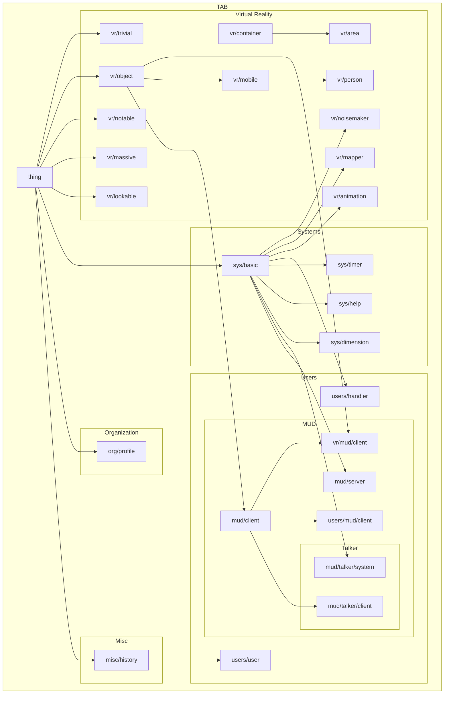

# TAB
*Things with Attributes and Behaviors*

> ***TAB*** is a system for structuring information to allow for computed analysis & manipulation.

TAB uses the Fennel programming language to establish a set of constructs to provide a framework for operations: A *thing* is *made* from a *model* defining the thing's *attributes* and *behaviors*.

***Note:*** TAB is currently in the earliest stages of development, and is created as a hobby-project. Code is incomplete, buggy, likely to change, and unlikely to ever be suitable for use by others.

## Getting Started

To use TAB, you'll need Lua & Git installed on your system.

	$ make tab-bin
	
Once that's done, you can start the Fennel REPL with the `fennel` command, and from there you can load in TAB and start making things:

```
>> (local tab (require :tab))
nil
>> (local apple (tab.make-thing :vr/object {:name :apple}))
nil
>> (local backpack (tab.make-thing :vr/container {:name :backpack}))
nil
>> backpack.contents
[]
>> (apple:move backpack)
nil
>> (tab.list-values backpack.contents :name)
["apple"]
```

## Map of Models



## Verification

Run `make test` with Lua 5.4 and `find` available (`make test LUA=lua5.4`
if the interpreter is version-named). Tests load the vendored Fennel compiler
and actual TAB source, exercise filesystem scans and folder loading, and check
that the MUD users handler cannot become ready after a failed scan.

Directory scans raise an error if the child process cannot start or exits
unsuccessfully. Empty results indicate a successful scan, not missing data.
Callers that deliberately recover can use `pcall`; required-data loaders let
the error propagate rather than treating unavailable data as an empty world.

Scan paths are passed literally to `find`, including spaces, quotes, dollar
signs and backticks. The optional type is limited to the documented `f` and
`d` values; invalid types and empty/NUL-containing paths fail before starting
a process. Scanning uses NUL-delimited `find -print0` output, so embedded
newlines remain filename data. A read failure, unsuccessful child exit or
incomplete final record raises an error rather than returning partial names.
Output is read in 8192-byte chunks, retaining only the unfinished record between
reads in addition to the returned name list.

## Research notes

[Preserved research and design notes](docs/dev/notes/README.md) discuss economic,
evidence and game-design ideas in a historical JavaScript/predication context.
They are not the current Fennel API or evidence of implemented economic features.
